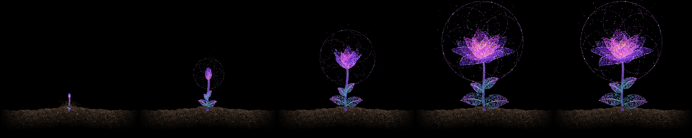

# Pointillism Flower

🇺🇸 [English](README.md) | 🇧🇷 **Português**

Uma flor feita de milhares de pontinhos que nasce da terra, cresce, desabrocha e fica viva e brilhando para sempre. Tudo é gerado com NumPy e desenhado pixel a pixel, sem nenhuma imagem pronta.



## Requisitos

- Python 3.9+
- NumPy, Pillow e PyInstaller
- Tkinter (já vem com o Python no Windows e no macOS; no Linux pode ser preciso instalar `python3-tk`)

## Instalação

**Windows**: crie o ambiente virtual e instale as dependências:

```powershell
python -m venv .venv
.\.venv\Scripts\python.exe -m pip install numpy Pillow pyinstaller
```

**Linux / macOS**:

```bash
python3 -m pip install numpy Pillow
```

Nesse caso, rode os comandos abaixo com `python3` no lugar de `.\.venv\Scripts\python.exe`.

## Como usar

Abrir a animação em uma janela:

```powershell
.\.venv\Scripts\python.exe flower.py
```

### Controles da janela

| Tecla | Ação |
|-------|------|
| `Espaço` | Pausa / continua |
| `R` | Recomeça do zero |
| `S` | Salva o quadro atual em `flower_frame.png` |
| `Esc` | Fecha |